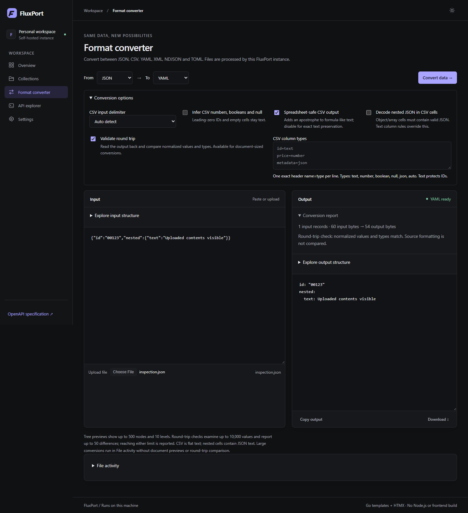

# FluxPort

**Turn data files into REST APIs. Convert formats with confidence.**

FluxPort is a small, self-hosted workspace for JSON, CSV, YAML, XML, NDJSON and TOML. Import files, browse records, expose an API, and inspect conversions—all from one executable.

[Download](https://github.com/PhantomPixelDev/FluxPort/releases/latest) · [Documentation](docs/reference.md) · [Hosted instance](https://fluxport.ppxl.dev) · [Report an issue](https://github.com/PhantomPixelDev/FluxPort/issues)

## Why FluxPort?

- **Files stay files.** SQLite stores metadata and disposable indexes; your source files remain accessible.
- **Six formats, one workspace.** JSON, CSV, YAML, XML, NDJSON and TOML.
- **Practical APIs.** Pagination, search, schema inspection, transformations, bearer authentication and optional CRUD for small collections.
- **Conversions you can inspect.** Exact-value tree previews, conversion reports, field-path round-trip differences and useful errors.
- **CSV controls.** Delimiter detection, optional type inference, per-column rules, nested JSON cells and spreadsheet-safe downloads.
- **Large-file workflows.** Streaming JSON arrays, CSV and NDJSON, disk-backed pagination, background jobs, progress, cancellation and retry.
- **Simple to run.** Go + embedded HTML/HTMX + SQLite. No Node.js runtime, frontend build step, CDN or external database.

## Get started

Download a Windows or Linux amd64 executable from [Releases](https://github.com/PhantomPixelDev/FluxPort/releases/latest).

**Windows**

    .\fluxport-windows-amd64.exe serve

**Linux**

    chmod +x fluxport-linux-amd64
    ./fluxport-linux-amd64 serve

Open **http://127.0.0.1:8080**. Import a file in **Collections**, or click **Load demo data** for six small synthetic examples. Normal installations load examples only when requested. The public demo preloads JSON, CSV, YAML, XML, NDJSON and TOML examples and its API needs no bearer token.

Use **Data workflow** for the import → inspect → convert → download steps. Collection previews support full-dataset search, 20/50/100-row pages, page jumps and remembered visible columns. In **Convert data**, choose **Use an existing collection** to convert its complete source without uploading it again. Nested documents keep their original root; large conversions run in File activity. Creating a conversion snapshot temporarily needs additional disk space.

The default data and state folders are <code>data/</code> and <code>.fluxport/</code>, relative to the working directory. Back up both. The hosted instance is a public demo with a shared workspace; download FluxPort to use your own instance.

### Build from source

Requires Go 1.26 or newer to build. The executable needs no Go installation.

    git clone https://github.com/PhantomPixelDev/FluxPort.git
    cd FluxPort
    go build -trimpath -ldflags="-s -w" -o fluxport ./cmd/fluxport
    ./fluxport serve

On Windows, build with <code>-o fluxport.exe</code>.

## Convert without starting a server

    fluxport convert input.json --to yaml --output output.yaml
    fluxport convert input.csv --to json --delimiter auto --infer-types
    fluxport convert input.json --to csv --spreadsheet-safe --output output.csv
    fluxport convert input.csv --to json --parse-json-cells
    fluxport convert - --from json --to ndjson

The input path comes before flags. Output defaults to stdout. Use <code>--column-types</code> with multiline <code>name=type</code> rules to protect IDs or choose text, number, boolean, null, json or auto.

## Expose a file as an API

Import a file, open its collection, and copy its endpoint from the dashboard or API explorer.

    GET /api/collections/{collection-id}?page=1&limit=50
    Authorization: Bearer YOUR_API_KEY

Search with <code>q</code>, inspect <code>/schema</code>, and choose output with <code>?format=csv</code> or the <code>Accept</code> header. Page sizes are capped at 100. Collections being indexed return <code>503</code> with <code>Retry-After</code>.

CRUD is opt-in, limited to supported small collections, and uses **zero-based row positions**, not an <code>id</code> field. Large collections are read-only. [API and configuration reference →](docs/reference.md)

## Self-host with Docker

Set separate strong secrets for the dashboard and API before starting:

    export FLUXPORT_ADMIN_PASSWORD='your-strong-dashboard-password'
    export FLUXPORT_API_KEY='your-separate-random-api-key'
    docker compose up -d --build

Compose binds to <code>127.0.0.1:8080</code> and persists data/state in named volumes. For remote access, use a TLS reverse proxy and configure authentication. Never commit credentials.

| Setting | Default |
| --- | --- |
| FLUXPORT_ADDRESS | 127.0.0.1:8080 |
| FLUXPORT_PUBLIC_DEMO | false; allows a public dashboard, disables API bearer authentication and preloads six example datasets |
| FLUXPORT_DATA_DIR / FLUXPORT_STATE_DIR | data / .fluxport |
| FLUXPORT_MAX_FILE_BYTES | 16 MiB for buffered documents and CRUD |
| FLUXPORT_MAX_RECORD_BYTES | 1 MiB per streaming record |
| FLUXPORT_MIN_FREE_DISK_BYTES | 256 MiB reserve |
| FLUXPORT_WORKERS | Up to two, limited by CPUs |

## Format boundaries

Formats cannot all represent the same data. FluxPort reports differences rather than promising perfect conversion:

- CSV is flat text. Nested values become JSON cell text; null and missing cells become empty text. Inference is optional and protects leading-zero identifiers.
- TOML has no null, requires an object root for small conversions and has numeric limits.
- XML export uses a typed JSON envelope. General XML import maps attributes and ordered mixed content.
- YAML preserves precise numeric text and date text; unsupported tags and non-JSON values produce errors.
- JSON duplicate keys and invalid Unicode are rejected.

JSON arrays, CSV and NDJSON stream without a default whole-file ceiling. Capacity still depends on disk, per-record limits and workload. Other document formats use the configured size limit. Tree previews and round-trip reports are bounded and apply to document-sized conversions.

[Conversion fidelity](docs/conversion-fidelity.md) · [Inspection controls](docs/converter-inspection.md) · [Large-file architecture](docs/architecture.md)

## Test data and development

    fluxport fixtures --suite smoke --out examples-local --seed 42
    fluxport fixtures --suite integration --out artifacts/fixtures --seed 42
    go test ./...
    go test -race ./...
    go vet ./...

Fixtures cover realistic users, products, orders and events across all six formats, with deterministic manifests and edge cases. Large/stress suites are opt-in and stay outside source control.

[Dataset guide](docs/datasets.md) · [Verification](docs/verification.md) · [Measured performance](docs/performance.md)

## Contributing

Bug reports with a small input, source/target formats, expected result and actual result are especially useful. Do not include private data or credentials. Run the Go checks before submitting a change.

## License

[MIT](LICENSE). Bundled third-party assets retain their own notices.
