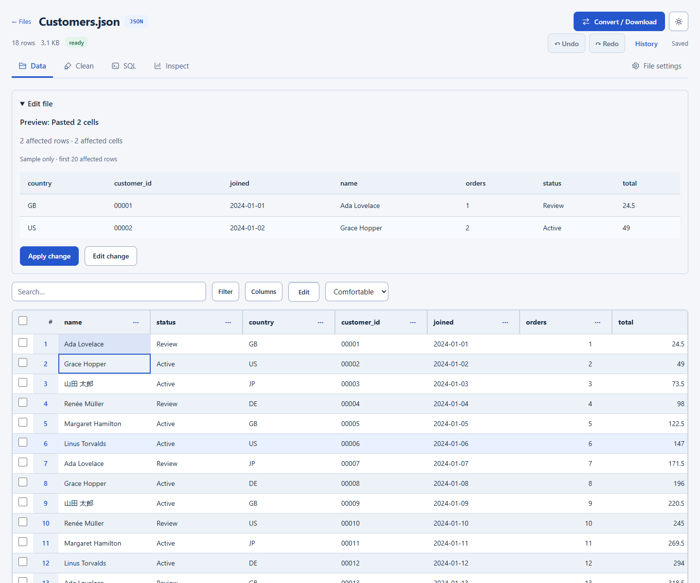

# Work on a file

Open a file from **Files**. **Data · Clean · SQL · Summary** stay within that file. Tables, editors and results use the main page. **Convert / Download** is always in the header; the **⋯ More file options** menu holds File settings, API settings, Saved views, File history and Processing history.

This guide covers the everyday file workflow. For team and production workflows, see [data engineering](data-engineering.md): compare file versions, set data contracts, export rejected rows, parameterize recipes, and reshape nested data.

## Edit and browse

Search, filter, sort, resize or hide columns in **Data**. Numbered pagination browses the complete file. Comfortable is the default density; saved Compact preferences are retained. Missing, null and empty text have distinct markers. Copy preserves complete values, including large integers.

Double-click a cell, or focus it and press Enter, to edit. Enter saves; Escape cancels. JSON objects, arrays, long values and scalar documents open a larger editor. JSON edits are validated without rounding numbers. Strings in CSV remain text. Selected rows can also be updated, replaced or deleted through **Edit selected rows**; deletion requires confirmation.

Direct editing supports text formats within the configured buffered-file limit (16 MiB by default) and 100,000 rows. Excel, Parquet and larger files stay read-only. Editing the dashboard file does not enable the public REST API or its CRUD flag.

To start from a read-only source, use **Create editable copy** in Clean. It creates a separate JSON file from the current matching rows in displayed order, or from the entire file. The original is unchanged. See [Create an editable copy](#create-an-editable-copy) for limits and job behavior.

## Select, paste and change the table

Click a cell and use arrow keys or Tab to move. Shift-click, Shift-arrow or drag selects a rectangle on the current page. Copy selections as TSV or copy complete records as JSON from **Edit**; JSON retains exact numbers, missing properties and nulls. A different filter or page clears the selection.

**Edit** provides Add row, Add column, Rename column, Delete selected rows/columns and Fill down. Column names are literal, so dots and slashes do not address nested objects. Fill down copies the first selected row's values to later selected rows. Nested edits retain their existing JSON editor.

Paste spreadsheet cells directly onto a focused cell or choose **Edit → Paste data**. Review the destination and sample, then Apply change. Values remain text by default. Explicit conversion recognizes valid JSON numbers, booleans and null; identifiers with leading zeros remain text. CSV saves text cells regardless. Quoted tabs, embedded newlines, CRLF within quoted values, Unicode and large numeric text are retained.

A paste supports at most **1,000 rows, 5,000 cells and the 1 MiB encoded request limit**. It never silently creates columns or overwrites extra rows. Choose Append explicitly to add rows; for an empty array, name the new columns explicitly. The server validates the entire action before saving. Each paste or structural action is one Undo step. Source changes require reload/review instead of overwriting newer data.

New rows append to the file; a current filter can hide them. Native forms provide the same preview/apply flow when JavaScript is disabled.

## Undo and history

**Undo** and **Redo** restore saved file contents. Ctrl/Cmd+Z and Ctrl/Cmd+Shift+Z work outside text inputs; inputs retain native editing shortcuts. **History** lists saved versions and lets you restore one as a new change. The newest versions are retained, up to 20 saves or 64 MiB per file. The baseline counts as one version.

History persists in the state directory. Keep both source and state volumes in backups. Source writes are atomic and journaled; startup reconciles interrupted writes without rewriting the source. Undo restores exact saved bytes and record identities. New edits after Undo discard the redo branch. External source changes require a reload. History is recovery for recent work, not a substitute for backups.

## Clean

Choose **Rows to clean**, a change, its column and **Apply change**. The file table stays below the controls. For editable files, Apply saves to the same file; Undo restores the previous version. File formatting may be normalized when writing.

**Matching rows** includes every match across all pages. Text and column changes preserve unmatched rows and source positions. Explicit sort, join and row-producing operations place their output into the matched positions, retaining unrelated rows. **Entire file** processes every row. The input query is captured explicitly; **Use current filter** recaptures it.

Saved steps and advanced joins remain available. Loading saved steps previews them; **Apply to file** explicitly saves them. Nothing runs merely from restoring a view or SQL draft.

For read-only files, cleanup prepares a separate working preview for download. The preview replaces the visible table rather than introducing Original/Cleaned tabs. Full prepared results provide filtering, sorting and pagination after the quick sample. They expire after 24 hours and never appear as extra collections. A changed source requires preparing again.

### Find and replace

Open **Find and replace in file** from Clean, or choose it under Edit. Select text columns and use selected rows or all matching rows across every page. Matching is literal and case-sensitive. Review the exact affected count and the first 20 affected rows; applying creates one undoable save. Non-text values remain untouched.

### Create an editable copy

Excel, Parquet and large sources remain read-only. **Create editable copy** generates a separate JSON file from matching rows in their displayed order, or the entire file. It includes every column. Copies must fit **100,000 rows and the configured buffered-file ceiling**, including encoded output bytes.

The cancellable background job streams into private staging storage. Only a complete copy becomes a collection, with a readable source-based name and independent history. The original source is unchanged. Narrow filters if the result exceeds editing limits. Progress uses SSE; native forms offer manual status refresh, cancellation, retry and a link to the ready copy.

## SQL and inspection

SQL queries the current source file. The editor is followed by Run, engine selection and results. Saved queries/history remain collapsed; restoring SQL text never executes it. SQL exports use **Run and download** and retain the existing result limits.

For deeper workflows, SQL also supports named scalar parameters, a searchable table/column picker and **Explain query**. See [SQL assistance](data-engineering.md#sql-assistance) for syntax and CLI/API examples. The SQL view queries the original source, even when a cleaned result is visible.

**Summary** is one column table. Expand a row to see statistics and common values. Checks, Schema and JSON have their own full-width views. Summary scans are bounded and label sample coverage, distinct-count limits and tracked values; missing, null and empty text remain separate.

## Convert / Download

Choose **Data**, **Rows** and **Format**, then Download. File data uses current saved contents. All matching rows includes every page in the displayed sort order; Entire dataset omits browsing filters. Original file streams exact current source bytes, including all Excel sheets.

Read-only cleanup previews and saved steps remain available as download sources. Background exports show preparation, failure/retry and the ready file. SSE updates progress without polling. Without JavaScript, native links/forms work and provide manual status refresh.

Excel saves text cells; Parquet offers lossless JSON records or typed analytical columns. **Format details** explains mappings; incompatible conversions fail explicitly. Public filenames use the display name rather than disposable job IDs.

The last export format is remembered per file in this browser. Files also offers browser-local Recently opened shortcuts that restore existing workspace state. Neither feature executes SQL or starts a download automatically.

## Compatibility and recovery

Existing collection IDs, authentication, CSRF, APIs and query semantics remain intact. Legacy pipeline requests without the file-edit option keep their preview/export behavior. REST mutations still require their existing flags. Source deletion remains a separately confirmed action.

File history uses metadata schema 10. Back up source and state together before upgrading; restoring an older application requires the matching pre-upgrade state backup. Processing history is collection-specific; library history is global.

## Import options and data checks

When adding text files, **Text import options** can preview up to 20 records, select UTF-8, Windows-1252 or UTF-16 encoding, and choose comma, tab, semicolon, pipe or automatic CSV delimiter detection. Gzip text files are decompressed during import. Explicit non-default settings normalize the uploaded file into an NDJSON source; the uploaded bytes are not retained as the source. Previewing does not validate the unscanned remainder. See [import interpretation](data-engineering.md#import-interpretation).

Use **Summary → Checks** to compare two collection versions or define a data contract. Full validation and rejected-row export run as background jobs. These checks do not alter either source. See [contracts and invalid rows](data-engineering.md#contracts-and-invalid-rows).
