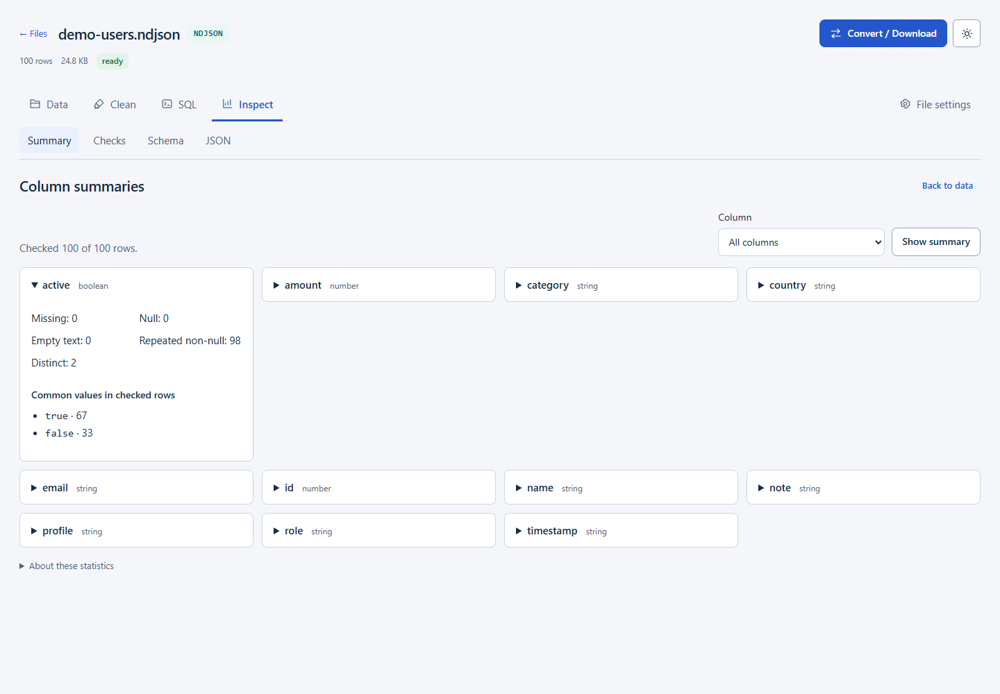

# FluxPort

### Inspect layout and search controls (0.3.15)

Inspect → Summary shows compact column cards. Expand a card to see missing, null, empty, distinct and common values; use the Column selector to focus on one field. Cards wrap to the available width and retain native keyboard and no-JavaScript operation. Sampling limits and cleanup suggestions are unchanged.



### Focused collection views (0.3.14)

Collection pages share Data, Clean, SQL and Inspect views. Existing view URLs still return full native pages. Opt in to a dedicated HTML view fragment using `X-Fluxport-View: workspace`; responses vary by this header. Existing HTMX data fragments and compact export responses retain their contracts. Source editing, format mappings and processing limits are unchanged.

Browser workspace state is versioned and scoped to the collection. Existing drafts/preferences migrate; invalid stored URLs and unavailable views/results are ignored or show a preparation recovery action. SQL is never executed merely by restoring a view.

### Captured cleanup and prepared results (0.3.12)

`POST /collections/:id/cleaned-results` accepts a JSON pipeline in form field `definition`, optional `source_generation`, and the existing CSRF token. The URL pins ownership. Native forms redirect to `?result_id=<job-id>`; `HX-Request: true` returns a compact progress/result fragment. `GET /collections/:id/cleaned-results/:result` provides the same fragment, or redirects native navigation to the collection. Use `retry=<preparation-job-id>` on POST to prepare again.

Workbench GET and export POST accept optional `result_id`. Cross-collection references are rejected, and prepared results cannot be edited. Export forms accept `query` plus `scope=matching|entire`; pagination is ignored for exports. The default is every matching row in order. `dataset=current` with `result_id` reuses a cleaned index, or stages the export behind its preparation. Existing callers omitting these inputs retain their behavior. The new chooser sends `original_shortcut=1` for an explicit whole-source download; `GET .../export?original=1` remains the exact-byte shortcut.

`GET /jobs?collection=<collection-id>` limits HTML history before its 100-job cap. Omitting collection keeps global history. Persisted pipeline JSON optionally includes `input_query` with search, filters and sort; page/limit are normalized away. Existing definitions use the entire source. SQL continues querying original collections.

Dashboard additions: `GET /collections/:id/insights?field=<literal-column-name>` provides bounded column summaries; `POST /collections/:id/sheet` selects an Excel worksheet using `sheet` and CSRF. `GET` or `POST /collections/:id/export-check` accepts `format` and optional `pipeline` to review sampled format changes. POST requires CSRF; preparation still uses the existing export endpoint. Format checks scan at most 100 source rows / 8 MiB, or the existing 20-row pipeline preview, and cannot guarantee compatibility beyond that sample. Original-source reviews perform no scan. The quality request accepts an optional literal `column` to profile a wide dataset one column at a time.

An embedded, server-rendered developer dashboard that turns local files into REST APIs. Go + Fiber v3, Go HTML templates, HTMX, vanilla CSS/JS, SQLite, and fsnotify. No frontend build process, CDN, Node.js runtime, or JavaScript application framework.

## Run

Requires Go 1.26 or newer **to build**. The resulting executable needs no Go installation and no CGO runtime.

```sh
go build -trimpath -ldflags="-s -w" -o fluxport ./cmd/fluxport
./fluxport --help
./fluxport version
./fluxport serve
```

On Windows, use `-o fluxport.exe` and `./fluxport.exe`. Open [localhost:8080](http://localhost:8080). The default address is loopback; an empty `data/` and `.fluxport/` are created automatically. Import a file through Collections, or copy `examples/people.json` into `data/`. The CLI embeds every template, stylesheet, script, and SVG, including a licensed local copy of HTMX 2.0.8.

```sh
./fluxport convert examples/people.json --to xml
./fluxport convert examples/people.json --to yaml --output people.yaml
./fluxport convert - --from json --to ndjson
```

Input filename comes before flags. Output defaults to stdout. Conversion works without starting the server or opening SQLite.

## Dashboard

The collection workspace opens cleanup, SQL, downloads and inspection tools beside one main table. Cleanup captures an ordered source query across all pages. A quick sample is replaced by the complete, read-only paginated result when preparation finishes. Later output filters affect browsing and downloads, not the captured cleanup input. `GET` and `POST /collections/:id/sql` provide SQL scoped to that file, including its saved queries and history. POST requires the existing CSRF token; the global `/sql` interface remains available. Panel navigation preserves in-page drafts and table state. Native forms remain usable without JavaScript.

Compact export forms can additionally choose `dataset=original`, a saved recipe ID, or `dataset=current` plus a JSON `draft` pipeline definition. Drafts are capped at 64 KiB and 20 steps, pinned to the collection in the URL, and validated before a job is created. Downloading current cleanup does not create or overwrite saved recipes. Existing `pipeline` form fields and non-compact callers keep their previous behavior. The same draft/source fields work for POST format checks; these remain optional and sampled. Dashboard JavaScript starts the requested file download once its job is ready, with a manual fallback link and native no-JavaScript status forms.

- **Overview:** collection, record, endpoint, and source-size totals.
- **Collections:** expandable multi-file imports and drag-and-drop, editable names, per-file jobs, refresh/retry and endpoint controls. Remove preserves the source and persistently excludes it from discovery; Excluded files provides Restore. Delete source file is separate and explicitly confirmed.
- **File workspace:** One table with Clean and Convert / Download actions. Clean applies common changes to captured matching rows and automatically prepares a complete result. Convert / Download includes all matching displayed rows, in order, using readable filenames. Original file preserves all source bytes. Table options contain columns and density; Desktop shows SQL, summaries, validation, JSON, schema, API settings, file settings, saved views and history next to Convert / Download. Mobile puts these shortcuts under ⋯ More. Advanced cleanup options remain collapsed. Existing direct links and workbench endpoints still work.
- **Format converter:** raw and collapsible tree previews, uploaded-input previews, conversion reports, optional round-trip checks, CSV column controls, actionable errors, clipboard copy, and downloads. See [converter inspection](converter-inspection.md).
- **API explorer:** same-origin requests, method, endpoint, query parameters, headers, JSON request body, status, response preview, and cURL copy. API keys are held only in the page, never browser storage. The preview is capped at 1 MB.
- **Settings:** persistent watcher toggle and instance configuration information. No polling.

Dark/light themes, responsive sidebar, keyboard focus, labels, live feedback, reduced-motion support, and system fonts are included. Page navigation is standard HTML. HTMX returns only affected HTML fragments for searches, pagination, tabs, imports, settings, and other mutations. Template data is auto-escaped; client response previews use `textContent`.

## Configuration

Optional JSON configuration: set `FLUXPORT_CONFIG=examples/config.json`. Environment variables override the file. Relative directory paths resolve against the process working directory.

| Variable | JSON key | Default |
| --- | --- | --- |
| `FLUXPORT_ADDRESS` | `address` | `127.0.0.1:8080` |
| `FLUXPORT_DATA_DIR` | `data_dir` | `data` |
| `FLUXPORT_STATE_DIR` | `state_dir` | `.fluxport` |
| `FLUXPORT_ADMIN_PASSWORD` | `admin_password` | Unset; local dashboard access |
| `FLUXPORT_API_KEY` | `api_key` | Unset; API access without bearer authentication |
| `FLUXPORT_MAX_FILE_BYTES` | `max_file_bytes` | `16777216` (16 MiB buffered documents / CRUD) |
| `FLUXPORT_WORKERS` | `workers` | Up to 2, limited by CPUs |
| `FLUXPORT_MAX_RECORD_BYTES` | `max_record_bytes` | `1048576` (1 MiB; configurable 1 KiB–16 MiB) |
| `FLUXPORT_MAX_STREAM_BYTES` | `max_stream_bytes` | `0` (no whole-source ceiling) |
| `FLUXPORT_MIN_FREE_DISK_BYTES` | `min_free_disk_bytes` | `268435456` (256 MiB reserve) |
| `FLUXPORT_DUCKDB_MEMORY_BYTES` | `duckdb_memory_bytes` | `536870912` (512 MiB) |
| `FLUXPORT_DUCKDB_TEMP_BYTES` | `duckdb_temp_bytes` | `4294967296` (4 GiB spill cap) |
| `FLUXPORT_DUCKDB_TIMEOUT_SECONDS` | `duckdb_timeout_seconds` | `30` |
| `FLUXPORT_DUCKDB_TEMP_DIR` | `duckdb_temp_dir` | State directory `duckdb-tmp` |

Non-loopback binding requires a dashboard password unless FLUXPORT_PUBLIC_DEMO=true is explicitly configured for a public demo. Public demo mode disables API bearer authentication even if a key is configured; normal installations can set a separate API key. Use a TLS reverse proxy for remote access. Dashboard sessions are HMAC-signed, HttpOnly, SameSite=Strict cookies, expire after 12 hours, and invalidate on restart. HTTPS connections receive Secure cookies. All dashboard mutations, including login/logout, check a session-bound CSRF token. Login is rate-limited. API requests use bearer authentication independently of dashboard sessions and are not cookie-authenticated. A restrictive content security policy excludes inline scripts and third-party assets.

Versioned SQLite metadata holds collection IDs, names, exclusions, processing state, jobs, index generations, counts, endpoint configuration and settings. Source data remains in ordinary files. Back up both data and state directories. Metadata follows **paths**, so renaming a source creates a new collection ID; deleting and recreating a path also creates a new ID. Updates at the same path retain configuration.

## REST API

```text
GET    /api/collections?q=people&page=1&limit=20
GET    /api/collections/{id}?page=1&limit=50&q=Ada
GET    /api/collections/{id}/rows/{index}
GET    /api/collections/{id}/schema
GET    /api/jobs
GET    /api/jobs/{id}
POST   /api/jobs/{id}/cancel
POST   /api/jobs/{id}/retry
GET    /api/openapi.json
POST   /api/collections/{id}/rows
PUT    /api/collections/{id}/rows/{index}
PATCH  /api/collections/{id}/rows/{index}
DELETE /api/collections/{id}/rows/{index}
```

Authenticate with `Authorization: Bearer YOUR_KEY` when configured. IDs are available from the collection list and dashboard. Data endpoints return arrays; an object/scalar root becomes one record. Page sizes are capped at 100, with `X-Total-Count` and `X-Page` response headers. `q` searches the serialized transformed rows. `Accept` negotiates JSON, CSV, YAML, XML, NDJSON, or TOML; `?format=xml` takes precedence. Unsupported media types return 406. TOML cannot represent an array root, so a paginated data request for TOML returns a helpful 422; object exports and converter inputs can use TOML.

CRUD is disabled by default and must be enabled per collection. Sources above the buffered-document limit remain read-only; responses expose effective `read_only` and `crud` values. Successful writes schedule replacement indexes, so reads may briefly return 503. It requires an array source root, no transformations, and JSON request bodies. PATCH merges object fields and removes fields whose patch value is null. Identifiers are **zero-based source positions**, not a field named `id`; deleting rows changes later indexes. Row lookup after response transformations uses the transformed order. Atomic replacement protects against partial app-generated writes. Concurrent API mutations are serialized; external processes editing the same source can still conflict, so coordinate external writes while CRUD is enabled.

```json
{
  "select": ["name", "team"],
  "drop": ["secret"],
  "rename": {"name": "display_name"},
  "filter": {"active": true}
}
```

Transformations apply equality filtering, selection, dropping, then renaming, only to API output. Source previews and exports retain original values. No scripts or arbitrary code are evaluated.

## Formats and limits

JSON preserves numeric lexemes, and XML exports wrap JSON in `<fluxport encoding="json">` for lossless round trips, including arrays, nulls, and arbitrary field names. General XML imports map attributes to `@name`, mixed text to `#text`, and repeated child names to arrays; declared namespace prefixes are kept on element and attribute names, so `<a:x>` and `<b:x>` do not collapse into one key. DTDs are rejected; XML depth is capped at 64. This is a documented data mapping, not an XML document-preservation tool.

Output is written without HTML escaping: `<`, `>`, `&` appear as themselves instead of `\u003c` and `\u0026`, in every format. Numbers within signed 64 bits and finite floats round-trip exactly; a lexeme outside those bounds becomes an explicitly quoted string that reads back as the same characters rather than a document the parser rejects. A leading UTF-8 byte-order mark is trimmed from every import, and empty input reports a single message instead of a decoder error. Streaming and buffered conversion of the same records produce identical bytes.

CSV requires unique non-empty headers, imports cells as strings, and exports nested values as JSON text in cells. NDJSON requires one JSON value per non-empty line. YAML accepts one document; non-string map keys, non-finite values, and incompatible values produce validation errors. TOML requires an object root, cannot represent nulls, and uses signed 64-bit integers and floating-point decimals. Format changes may lose properties the target format cannot represent; incompatible structures fail explicitly.

Top-level JSON arrays, CSV and NDJSON use bounded record iterators and disposable SQLite indexes on disk. They have no whole-source ceiling by default. YAML, TOML, XML and document-shaped JSON remain bounded by the configurable document limit (16 MiB default, 1 KiB–256 MiB). Individual raw/normalized indexed records default to 1 MiB. Schemas are capped at 2,048 fields. Disk space and format capabilities remain limits; support is not literally unlimited.

Ordinary API/URL-encoded forms are limited to 1 MiB. Multipart text fields have separate bounds; file parts stream to staged files. Default workers are at most two, limited by CPUs. Disk reserve defaults to 256 MiB, checked in bounded batches. A replacement needs disk for the source, new index and any old generation still in use. Insufficient disk, malformed/oversized records or cancellation discard incomplete indexes/downloads without corrupting sources.

Ordinary pages seek indexed positions without reparsing. Filter/search/transformation queries scan with bounded memory and a 25-second deadline and can be slower. Schema is cached. Source previews show at most 20 records, 12 table columns, shortened cells and a 64 KiB raw display; the source remains intact.

Completed generations are atomically published only while source size/mtime, content checksum and collection job still match. Detected changes become pending; data endpoints return 503 with `Retry-After: 2` until replacement indexing finishes. Failed/cancelled sources remain unavailable until Refresh/Retry. Restart marks unfinished jobs interrupted; startup reconciliation schedules affected collections again. Missing indexes are rebuildable.

Native SSE pushes progress/completion/cancellation into HTMX fragments; no periodic browser polling runs. Watcher events debounce affected files/subtrees for 250 ms. Full scans are for startup, explicit reconciliation and overflow/event-storm recovery. Symlinks, hidden files/directories and private staging files are excluded.

Large conversions/exports stream to temporary downloadable files. Downloads and private conversion inputs have 24-hour retention, with cleanup on startup/new conversions. Regenerate expired exports or re-upload expired inputs. Streamed TOML wraps object records in `records`; synchronous small conversions retain object-root behavior. CLI file/stdin streaming uses bounded records and staged output; CSV output needs a schema pass before writing.

`GET /collections/:id/export?original=1` streams the exact current source bytes, including whitespace and line endings, even while indexing. Existing export requests retain their behavior. Dashboard callers can opt into a single-export HTML fragment with `POST /collections/:id/export`, `download_view=compact`, a supported `format` and the usual CSRF token. HTMX requests receive the fragment; ordinary form submissions redirect to the collection's export status. Updates reuse server-sent events rather than polling. The same compact mode supports job cancellation and retry; it does not expose the full job history. Excel stores values as text. Parquet defaults to lossless JSON records; `format=parquet-typed` is an additional export choice for typed analytical columns.

Static assets carry content-derived ETags and one-hour caching; dynamic responses use `no-store`. HTTP responses can be compressed. There are no unbounded caches or per-file watcher goroutines.

## Generated test data

```sh
./fluxport fixtures --suite smoke --out artifacts/fixtures/smoke --seed 42
./fluxport fixtures --suite integration --out artifacts/fixtures/integration --seed 42
./fluxport fixtures --suite large --out artifacts/fixtures/large --seed 42
./fluxport fixtures --suite stress --out artifacts/fixtures/stress --seed 42 --bytes 1073741824
```

Smoke generates 100 records per format, integration 10,000, and large both 100,000 and one million. Stress requires explicit `--rows` or `--bytes`, applied to each of six files: the 1 GiB example uses over 6 GiB before indexes. Generation is incremental and never overwrites existing datasets. Manifests record suite, seed, profile, counts, bytes, SHA-256 and format differences. Byte targets can exceed the target by one buffer/record plus framing.

[Committed smoke fixtures](../examples/fixtures/manifest.json) cover synthetic users/products/orders/events and edge cases. TOML counts describe records inside its wrapper; unchanged TOML object-root imports expose that document as one collection row. CSV uses text/empty cells. **Load demo data** adds six small examples once per instance. Public demo mode also loads them at startup; normal installations remain opt-in. Restarts never duplicate or restore user-removed examples. Large generated files belong in ignored `artifacts/`, never `ui/` or committed examples. See [dataset verification](datasets.md).

## Docker

```sh
export FLUXPORT_ADMIN_PASSWORD='choose-a-dashboard-password'
export FLUXPORT_API_KEY='choose-an-api-key'
docker compose up --build -d
```

In PowerShell use `$env:FLUXPORT_ADMIN_PASSWORD = '…'` and `$env:FLUXPORT_API_KEY = '…'`. Compose requires both secrets, binds the published port to localhost, and persists `/data` and `/state` in named volumes. The standard image includes DuckDB; standalone images must receive `FLUXPORT_ADMIN_PASSWORD` at runtime because they listen on all interfaces. See [DuckDB processing](duckdb.md) for build prerequisites and resource settings.

## Verification

```sh
go test ./...
go vet ./...
go test -race ./...
```

Tests exercise conversion round trips and failures, numeric precision, transformations, source bounds, filesystem events, metadata updates, atomic CRUD, dashboard rendering/escaping, fragments, cache validation, password sessions, CSRF, multipart imports, bearer authentication, pagination, negotiation, and OpenAPI generation. DuckDB is part of the standard executable; building and running race tests requires a compatible C/C++ toolchain. Downloaded executables do not require a compiler.

See [conversion fidelity and CSV options](conversion-fidelity.md), [architecture](architecture.md), [verification and browser checks](verification.md), and [release measurements](performance.md). Measurements report the actual test environment and are not guarantees.

## Source layout

`cmd/fluxport` owns the CLI. `internal/api` and `internal/web` keep REST and HTML handlers separate. `internal/auth`, `config`, `database`, `collections`, `conversion`, `filesystem`, `quality`, and `transformations` isolate backend responsibilities. `ui` embeds templates and static assets. SQLite migrations through version 9 are applied by `internal/database`. `internal/jobs`, `fixtures` and `resources` own background work, deterministic fixtures and resource checks. See [the processing workspace guide](platform.md) for Excel/Parquet mappings, quality checks, ordered cleanup steps, pipeline revisions, schedules, new CLI commands and remaining platform work.

Startup validates cached generations by SHA-256 before serving them; unchanged sources reuse their indexes without reparsing. Building an index hashes the bytes being parsed and verifies the source again before publication. Detected write events mark the source pending immediately, including same-size writes that preserve timestamps. External filesystems that miss events require explicit reconciliation/restart; reads cannot transactionally lock unrelated external writers.
